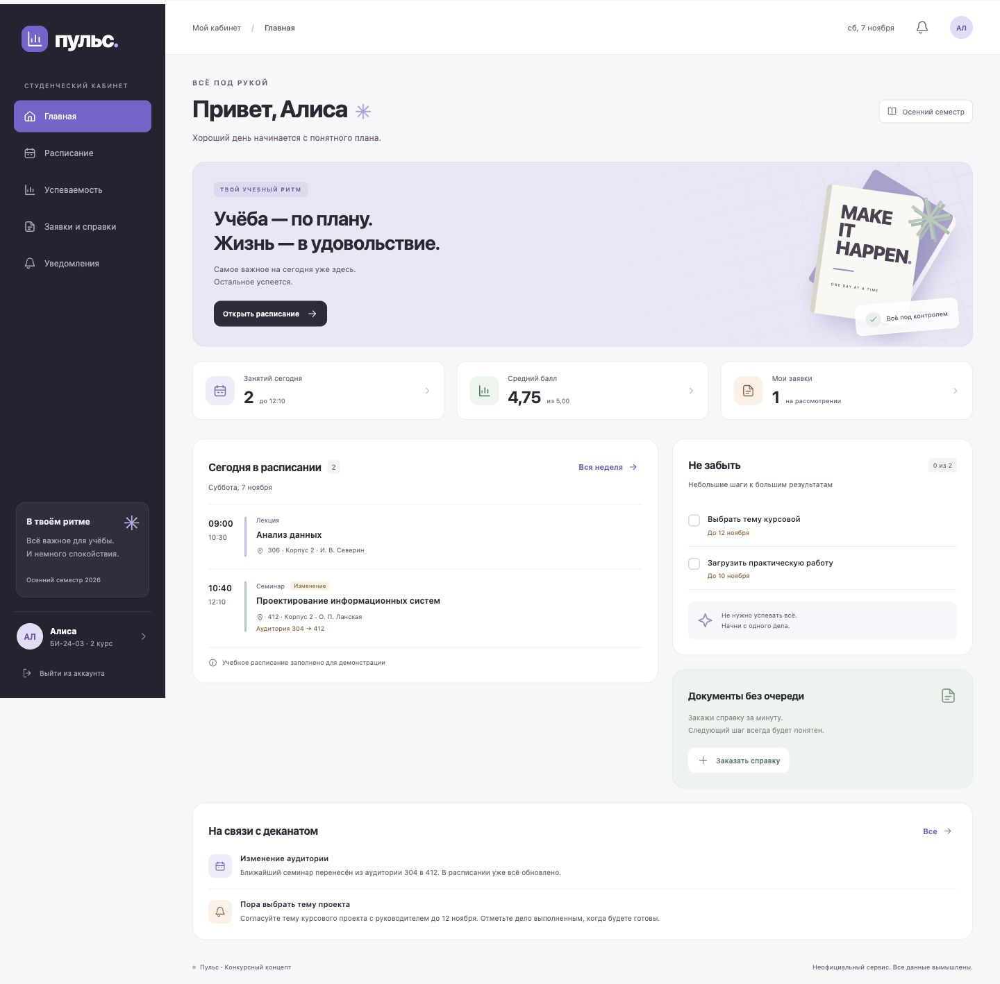
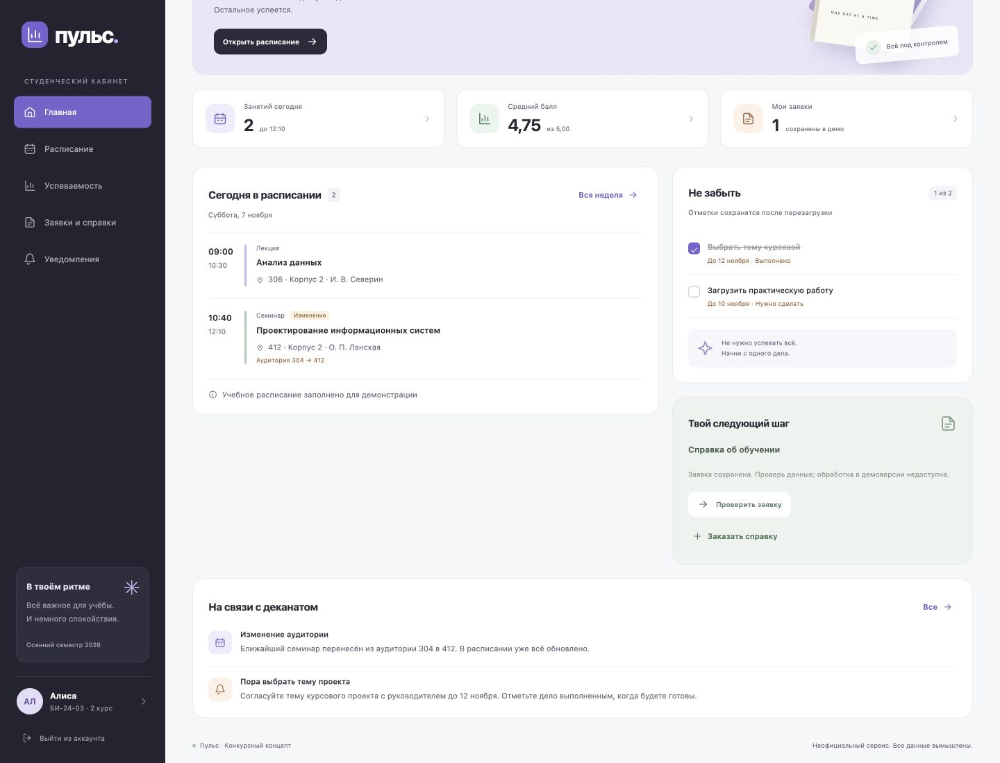
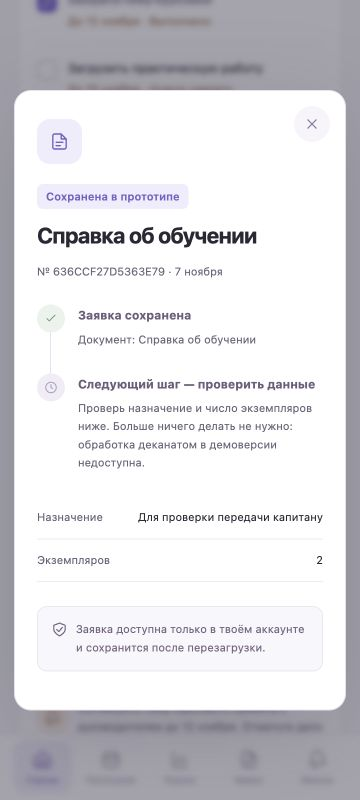
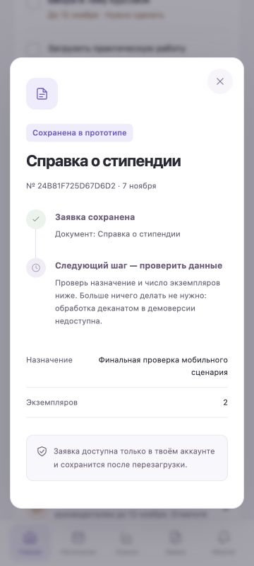

# Пульс цифровой деканат будущего

Черновик конкурсного описания для команды. Подготовлен 7 ноября 2026 года по реальной истории проекта. До отправки капитану нужно заполнить поля ниже, сверить правила конкурса и оформить документ/PDF. Здесь не заявляется наличие уже опубликованного сайта или записанного видео.

Команда: **[заполнить]**. Капитан: **[заполнить]**. Прототип: **[вставить проверенную внешнюю HTTPS-ссылку после самостоятельного размещения]**. Исходники: **[вставить доступную жюри ссылку на новый архив или репозиторий]**. Не вставляйте сюда рабочую БД, резервные копии и настоящие персональные данные.

## Проблема и идея

Учебная информация часто находится в нескольких местах: расписание отдельно, оценки отдельно, документы через деканат, объявления в чатах. Пульс собирает эти сценарии в одном личном кабинете. Целевая аудитория — студент, который хочет быстро понять свой учебный день и решить административную задачу с телефона.

Продуктовые гипотезы команды: единая главная сократит поиск нужного действия; понятный следующий шаг заявки снизит неопределённость после отправки. Интервью и опросы не проводились, поэтому эти идеи пока не подтверждены студентами. План будущей проверки из пяти заданий подготовлен отдельно в `usability-test.md`.

## Почему выбраны эти разделы

| Раздел | Задача студента |
| --- | --- |
| Вход и профиль | Узнать, чей кабинет открыт, увидеть направление, курс и группу, безопасно завершить сессию |
| Расписание | Найти занятия на сегодня и неделю, время, преподавателя и заметный перенос аудитории |
| Успеваемость | Увидеть дисциплины, баллы, оценки, зачёты и примерные даты сессии |
| Заявки и справки | Отправить заявку, получить номер, сохранить её и понять следующий шаг |
| Уведомления | Найти изменения и напоминания, перейти к соответствующему действию |

Главная связывает разделы: пары на сегодня, учебные дела с сохраняемыми отметками и карточка последней заявки. С неё можно проверить заявку или открыть готовый демообразец. Из уведомления о переносе открывается расписание, из напоминания — дела, из уведомления о справке — документ. Дополнительные разделы ради количества не добавлялись.

## Работающие сценарии и границы демонстрации

Студент может войти, посмотреть свой профиль, расписание и оценки, создать заявку с назначением и количеством экземпляров, снова открыть её после перезагрузки и перезапуска сервера, прочитать уведомление и отметить дело выполненным. Для второго студента сервер возвращает другой профиль и отдельные данные.

Новая заявка получает статус «Сохранена в прототипе». Следующий шаг предлагает проверить назначение и экземпляры; текст прямо сообщает, что настоящая обработка деканатом недоступна. У каждого студента заранее есть готовый демонстрационный образец справки: он скачивается текстовым файлом, помечен как вымышленный и не имеет юридической силы.

Внешней интеграции с университетом, настоящих персональных данных, официального логотипа, кабинета сотрудника, электронной подписи и AI-чата в продукте нет. AI использован для создания прототипа, а не для генерации недостоверных ответов студентам.

## Визуальная концепция

Светлая рабочая область, графитовая навигация, фиолетовый акцент и спокойные зелёные статусы. На широком экране разделы находятся слева; на телефоне — в нижнем меню, профиль доступен через аватар. Шрифты системные, изображения блокнота и знак проекта построены собственными CSS/SVG, без официальных логотипов и сторонних картинок.

При доработке увеличены небольшие подписи, улучшены действия по уведомлениям и следующий шаг заявки. Сохранены видимый фокус, циклический фокус в диалоге, Escape и возврат к кнопке, а также настройка уменьшения движения. Это не утверждение о полном WCAG-аудите.

## Как использовался ИИ

Работа выполнена с Codex в настольном приложении. **Точная модель не установлена** — идентификатор прошлой сессии не был зафиксирован, и мы его не угадываем. Другие ИИ-модели, дизайнерские генераторы изображений и субагенты в этой истории не использовались.

Codex разобрал задание, предложил концепцию, написал сервер, интерфейс, тесты и документацию, исправлял ошибки по результатам запуска. Использовались навыки Sites для локального workflow и Documents для чтения Word; сторонние навыки не устанавливались. Серверные проверки выполнялись Python unittest и HTTP-клиентом, интерфейс проверялся через CUA во встроенном браузере. Полный перечень фактически применённых средств и решений — в `ai-process.md`; лицензии и материалы — в `licenses.md`.

### Ключевые реальные задания из истории

Цитаты ниже доступны в переданных материалах и чате. Это не выдуманный набор промптов задним числом.

1. Конкурсное задание, переданное пользователем: «Собери с помощью ИИ-ассистентов рабочий прототип личного кабинета студента — „цифрового деканата будущего“». Оно определило пять обязательных разделов, мобильность и разделение данных.
2. Из первого Word-плана: «Не ограничивайся планом и описанием — создавай код, запускай проект и проверяй результат». Документ использовался как дополнительный план; он не менял системные правила работы ассистента.
3. Реальная обратная связь пользователя: «сайт не открывается». По скриншоту и состоянию процесса установлено, что локальный сервер был остановлен после тестов; сервер повторно запущен и страница проверена. Затем пользователь отдельно попросил остановить сервер, и это было выполнено.
4. Последний запрос пользователя: «Друг проверил проект и прислал следующий промт в прикреплённом документе. Продолжай работу над текущим проектом по этому промту». После этого выполнен второй этап доработки и передачи капитану.
5. Из принятого плана второго этапа: «Не публикуй сайт, не создавай хостинг, не делай репозиторий публичным и не отправляй заявку на конкурс». Поэтому подготовлена инструкция для самостоятельного размещения, а не вымышленный опубликованный результат.

Подзадачи сервера, дизайна и тестирования ассистент формулировал внутри выполнения; их краткое изложение в журнале явно отделено от дословных сообщений человека. Полных вымышленных диалогов и несуществующих ранних макетов нет.

## Ошибки и исправления

В среде не было Node.js, поэтому выбран Python со стандартной библиотекой и интерфейс без сборки. Встроенная сборка Python не поддерживала scrypt: использован PBKDF2-HMAC-SHA256 с отдельными солями и 600 000 итераций. В раннем SQL исправлено число параметров уведомления.

Первый HTTP-прогон выявил гонку: ответ об успешном входе мог прийти до фиксации сессии. Теперь изменения фиксируются до ответа. Во втором этапе исправлен возврат к входу при истечении сессии с открытым диалогом. Убраны подписи, которые могли создать впечатление настоящей обработки заявки; добавлено прямое действие на главной.

При подготовке размещения устранено изменение прав на произвольный существующий родительский каталог БД. Добавлены корректное копирование WAL, восстановление в новый файл со сбросом сессий и проверка доверенного прокси. Это не меняет стек и не является заявлением о промышленной готовности.

## Вход хранение и защита простыми словами

После входа браузер получает случайный пропуск на 12 часов. Он хранится в HttpOnly/SameSite cookie, а в базе — только его хеш. Выход удаляет пропуск на сервере. Пароли не хранятся открытым текстом в базе: каждому соответствует соль и вычисленный PBKDF2-хеш. Два специальных демопароля сообщаются жюри намеренно.

Каждый личный запрос проверяет сессию. Сервер выбирает заявку одновременно по её ID и владельцу; чужой ID не открывает документ. Изменения требуют CSRF-токен и проверку источника запроса. Служебные файлы не входят в разрешённый набор URL. Секретные API-ключи не нужны: внешних сервисов нет.

Заявки, пользователи, уведомления, дела и сессии живут в SQLite. Расписание и оценки — демонстрационные наборы серверного кода. Для размещения подготовлены переменные окружения, Secure cookie, проверка доверенного IP прокси, служебная проверка доступности и скрипты резервного копирования. После размещения капитан должен отдельно проверить HTTPS, прокси, сохранность диска и доступность из России.

## Результаты проверки

Обновление 8 ноября: добавлены собственные спокойные анимации входа, главной, навигации, диалогов и подтверждений. Реальные пределы новой проверки — в `motion-notes.md`: 15 серверных тестов и 11 изолированных JS-сценариев прошли; полный новый прогон 360 px и системного reduced motion заблокирован лимитом браузерного доступа. Приведённые ниже старые снимки показывают предыдущие этапы, не движение новой версии.

Сервер проверен 15 автоматическими тестами на временных базах: входы обоих студентов, чужие ID и подстановка владельца, сохранение после перезапуска, запрет служебных файлов, CSRF/Origin, валидация, хеши, истечение сессии, ограничение входов, backup/restore, настройки прокси/cookie и закрытие соединения при ошибке настройки. Финальный строгий прогон выполнен на Python 3.9.6; Python 3.14 недоступен. По сообщению капитана на 3.14 возникали ResourceWarning: найдены и явно закрыты соединения тестов. Проверка на самой 3.14 остаётся капитану; подробности и результаты нового прогона — в `final-check.md`.

Браузерная проверка охватывает входы и выходы обоих студентов, ошибку пароля, расписание дня и недели, оценки и сессию, создание и сохранение заявки, следующий шаг на главной, уведомления и дела, пустые состояния, профиль и клавиатурный диалог. Основные экраны проверены на 360 px, дополнительные размеры — отдельно. Подробная матрица «требование → реализация → доказательство → ограничения» находится в `requirements.md`, а пределы чистого запуска — в `release-notes.md`.

Проверка в эмуляции браузера не заменяет физический телефон. Внешний HTTPS-хостинг, доступность из России, Docker, полный аудит доступности и нагрузки пока не проверены. Это будет выполнено капитаном после выбора платформы.

## Снимки и история продукта

Снимки первой версии в `screenshots/` сохранены ранее; снимки доработки в `screenshots/review/` — реальные состояния текущей проверки. Они не сгенерированы. Раннего отдельного макета до кода не было; его изображения не выдумывались.

Новый финальный прогон на 360 px выполнен отдельно после устранения незакрытых соединений. Проверялась чистая распакованная копия. Показанная ниже справка создана в этом прогоне; подробные результаты и ограничение Python 3.14 — в `final-check.md`.

## Действия человека и оставшиеся шаги

Пользователь предоставил конкурсные материалы, сообщил об ошибке открытия сайта, управлял запуском сервера и явно поручил продолжить работу по плану друга. В документе друга сообщалось о проверке прежнего архива капитаном; это внешнее сообщение, а не независимый тест текущей сессии. Внутри этой работы собственные результаты запусков зафиксированы отдельно. Интервью, ручные правки дизайна человеком и дополнительные сервисы не приписываются команде без подтверждения.

Капитану остаётся выбрать и самостоятельно настроить размещение, пройти приёмку внешнего URL, проверить актуальные требования и документы участников, заполнить титульные поля и ссылки, оформить итоговый PDF/документ и отправить работу. Видео до пяти минут необязательно; подготовлен честный сценарий записи, само видео не создано.
